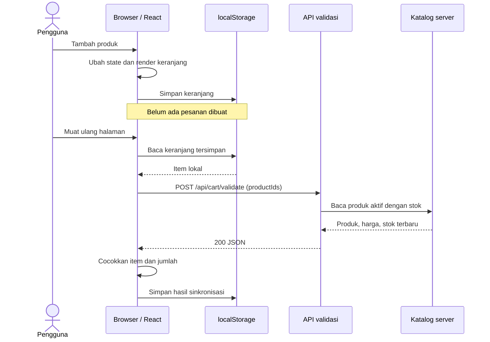

# Studi kasus: keranjang Brewtica

Observasi kode pada 23 Oktober 2026. Penjelasan ini ditulis untuk belajar; tidak menyalin implementasi privat Brewtica.

## Tiga tempat yang perlu dibedakan

**State di memori browser** dipakai untuk merender jumlah dan total keranjang. Saat pengguna menambah produk, React memperbarui tampilan berdasarkan state tersebut.

**localStorage** menyimpan salinan keranjang pada browser itu. Data ini dapat diedit pengguna dan tidak boleh dipercaya sebagai harga akhir transaksi. Penyimpanan tersebut berbeda dari database pesanan di server.

**Server** menyediakan informasi produk terbaru. Saat keranjang tersimpan dipulihkan, Brewtica memanggil endpoint validasi untuk mencocokkan produk aktif, harga, dan stok. Respons dapat mengubah tampilan keranjang, tetapi permintaan validasi itu tidak membuat pesanan.

## Alur yang dipelajari

Kode yang menjadi dasar observasi di repositori privat Brewtica: `src/context/CartContext.tsx` dan `src/app/api/cart/validate/route.ts`. Handler API menggunakan pembacaan katalog, bukan pembuatan order. Diagram ini menyederhanakan alur utama; jalur error juga perlu dipahami pada sesi berikutnya.

## Bedanya dengan mini lab

| Aspek | Mini lab | Brewtica |
|---|---|---|
| Rendering interaktif | JavaScript DOM langsung | React di atas Next.js |
| Katalog | Array simulasi di Node | Katalog dari database |
| Validasi keranjang | Tombol manual | Dipanggil saat pemulihan keranjang tersimpan |
| Penyimpanan lokal | `fso_part0_cart_demo_v1` | Storage aplikasi yang terpisah |
| Pembuatan pesanan | Tidak tersedia | Alur checkout terpisah |

Brewtica memadukan rendering server dan interaksi client. Karena itu, jangan menyebut seluruh aplikasinya sebagai SPA murni. Klik tambah keranjang sendiri tidak mengirim checkout; aplikasi nyata tetap dapat memiliki request lain seperti analytics atau prefetch.

## Hal yang perlu bisa dijelaskan

- Mengapa angka total yang terlihat di browser belum cukup untuk dipercaya server?
- Mengapa metode POST tidak selalu berarti data baru ditulis ke database?
- Apa yang harus terjadi ketika harga atau stok berubah setelah item disimpan di browser?

Jawaban dan bukti hasil pengamatan ditulis peserta dalam `part0/catatan-belajar.md`.
