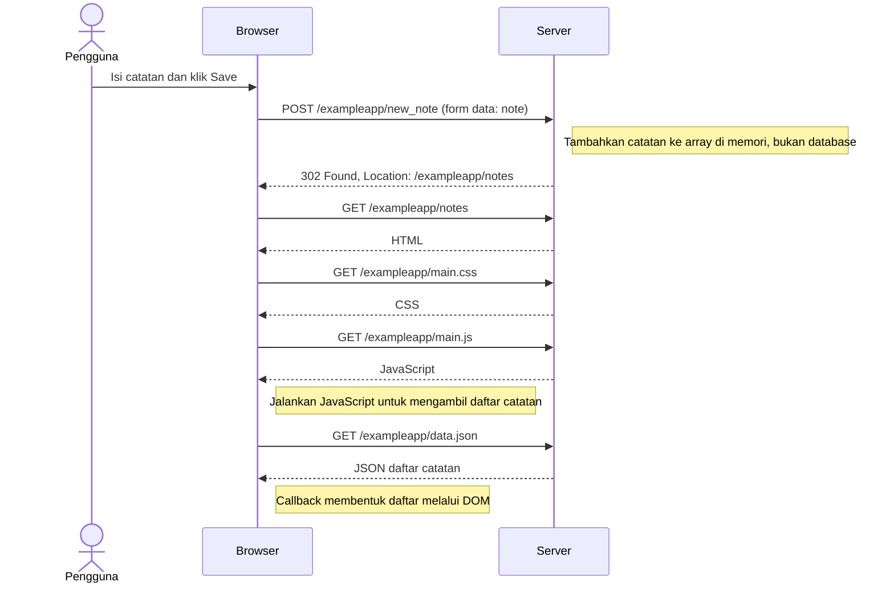

# 0.4 — New note diagram

**Review teknis selesai dengan bantuan AI; belum disubmit ke portal kursus.**

Halaman Notes sudah terbuka sebelum alur dimulai. Diagram mengikuti [materi resmi](https://fullstackopen.com/en/part0/fundamentals_of_web_apps/#forms-and-http-post).

Urutan CSS/JavaScript disederhanakan; fokus pada ketergantungan alur, bukan durasi unduhan.

## Review peserta

- [ ] Cocokkan POST, redirect, dan GET pada Network dengan Preserve log aktif.
- [x] Jelaskan mengapa GET notes mengikuti respons 302.
- [ ] Jelaskan perbedaannya dengan tombol validasi pada lab Brewtica.

Penjelasan peserta: "Browser mengirim GET ke /exampleapp/notes untuk mengambil halaman tujuan redirect."

Review sumber: POST dan redirect cocok dengan [index.js](https://github.com/mluukkai/example_app/blob/3a61b89f0b4ec3b8db9de97025564587f9e6ede0/index.js). Checklist Network di atas mencatat pengamatan peserta, bukan status pemeriksaan teknis.

Lanjutkan ke [0.5](0.5-spa-load.md) dan [0.6](0.6-spa-new-note.md). Jangan gunakan tombol Clear notes.
