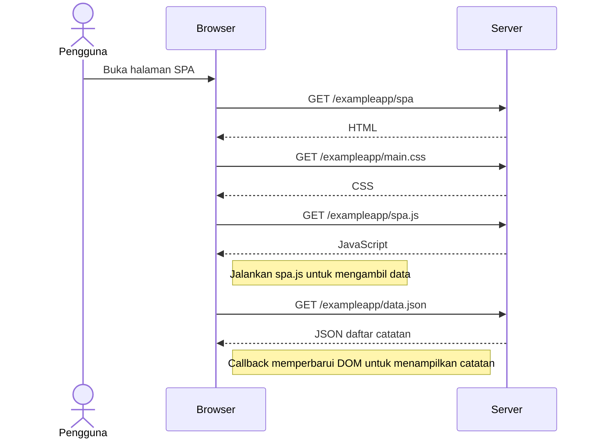

# 0.5 — Membuka aplikasi SPA

**Review teknis selesai dengan bantuan AI; belum disubmit ke portal kursus.**

Skenario: membuka https://studies.cs.helsinki.fi/exampleapp/spa, belum mengirim catatan baru. Mengikuti [materi resmi](https://fullstackopen.com/en/part0/fundamentals_of_web_apps/#single-page-app).

CSS dan JavaScript dapat diunduh secara paralel. Diagram menekankan ketergantungan; pemanfaatan cache dapat memengaruhi request yang terlihat.

## Review peserta

- [ ] Amati pemuatan halaman di Network dengan filter All.
- [ ] Temukan spa, main.css, spa.js, dan data.json.
- [x] Jelaskan perbedaan fungsi HTML dan JSON pada diagram.

Penjelasan peserta: "Karena HTML hanya menyediakan struktur halaman, sedangkan data.json berisi daftar catatan yang ditampilkan lewat DOM."

Mengirim catatan baru dibahas pada [draf latihan 0.6](0.6-spa-new-note.md).

Review sumber: berkas HTML serta pemuatan data cocok dengan [index.js](https://github.com/mluukkai/example_app/blob/3a61b89f0b4ec3b8db9de97025564587f9e6ede0/index.js) dan [spa.js](https://github.com/mluukkai/example_app/blob/3a61b89f0b4ec3b8db9de97025564587f9e6ede0/public/spa.js). Checklist Network mencatat pengamatan peserta secara terpisah.
