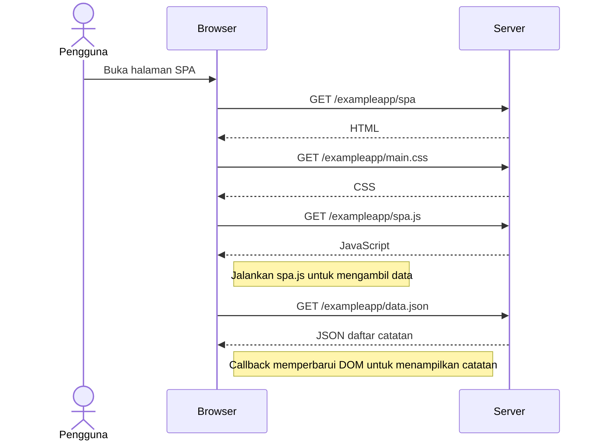

# 0.5 — Membuka aplikasi SPA

**Draf pendamping belajar dengan bantuan AI; menunggu review peserta. Belum disubmit.**

Skenario: membuka https://studies.cs.helsinki.fi/exampleapp/spa, belum mengirim catatan baru. Mengikuti [materi resmi](https://fullstackopen.com/en/part0/fundamentals_of_web_apps/#single-page-app).

CSS dan JavaScript dapat diunduh secara paralel. Diagram menekankan ketergantungan; pemanfaatan cache dapat memengaruhi request yang terlihat.

## Review peserta

- [ ] Amati pemuatan halaman di Network dengan filter All.
- [ ] Temukan spa, main.css, spa.js, dan data.json.
- [ ] Jelaskan perbedaan fungsi HTML dan JSON pada diagram.

Mengirim catatan baru merupakan skenario latihan 0.6, bukan alur diagram ini.
