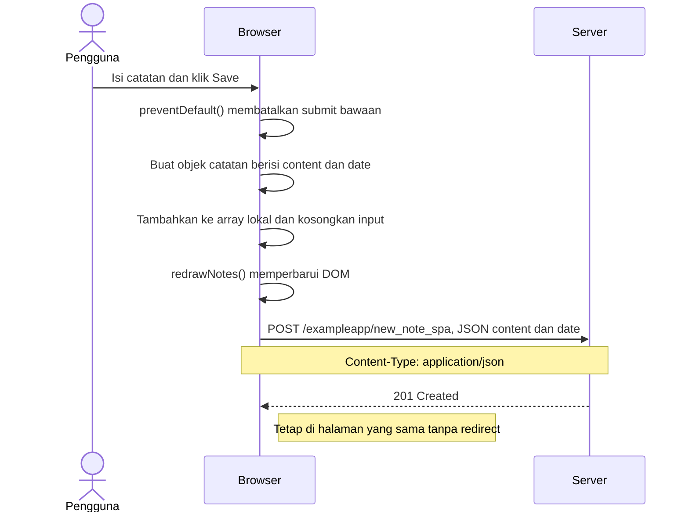

# 0.6 — Catatan baru pada SPA

**Review teknis selesai dengan bantuan AI; disubmit bersama Part 0 pada 23 Oktober 2026.**

Halaman SPA sudah terbuka. Mengikuti [materi resmi](https://fullstackopen.com/en/part0/fundamentals_of_web_apps/#single-page-app).

DOM diperbarui sebelum POST; tampilan baru sendiri belum membuktikan keberhasilan server.

## Review peserta

- [ ] Temukan POST new_note_spa, payload JSON, dan status respons.
- [ ] Jelaskan fungsi preventDefault dan urutan pembaruan DOM.

Pemahaman urutan DOM dan risiko kegagalan telah dikonfirmasi peserta: "Belum tentu, karena DOM sudah diperbarui sebelum POST dikirim. Kalau POST gagal, server belum tentu menerima catatan."

Review sumber: urutan redrawNotes sebelum sendToServer cocok dengan [spa.js](https://github.com/mluukkai/example_app/blob/3a61b89f0b4ec3b8db9de97025564587f9e6ede0/public/spa.js); respons 201 cocok dengan [index.js](https://github.com/mluukkai/example_app/blob/3a61b89f0b4ec3b8db9de97025564587f9e6ede0/index.js). Checklist pengamatan Network tetap terpisah dari review teknis.
