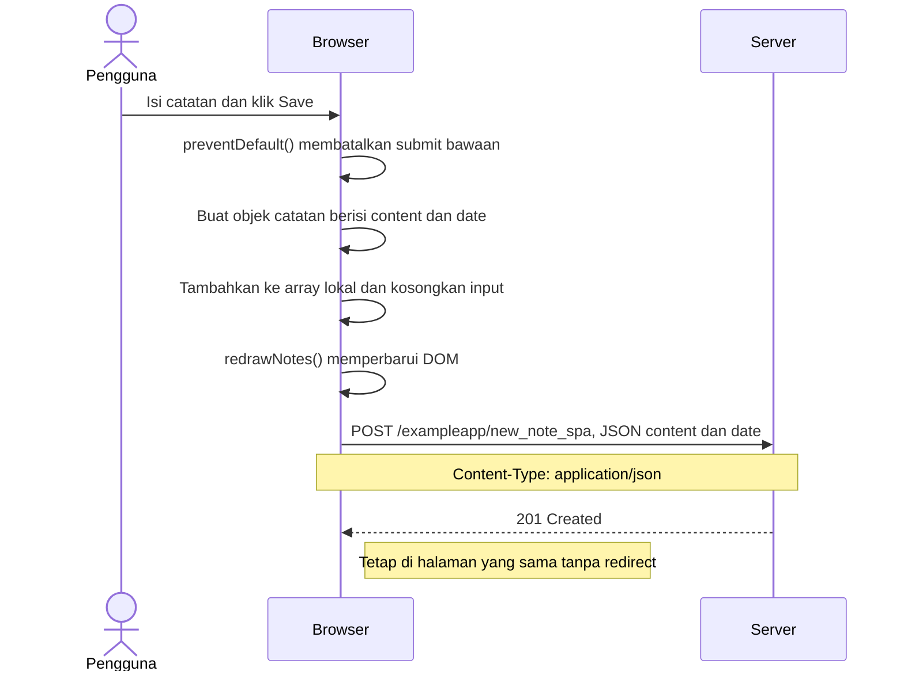

# 0.6 — Catatan baru pada SPA

**Draf dengan bantuan AI; menunggu review peserta. Belum disubmit.**

Halaman SPA sudah terbuka. Mengikuti [materi resmi](https://fullstackopen.com/en/part0/fundamentals_of_web_apps/#single-page-app).

DOM diperbarui sebelum POST; tampilan baru sendiri belum membuktikan keberhasilan server.

## Review peserta

- [ ] Temukan POST new_note_spa, payload JSON, dan status respons.
- [ ] Jelaskan fungsi preventDefault dan urutan pembaruan DOM.
